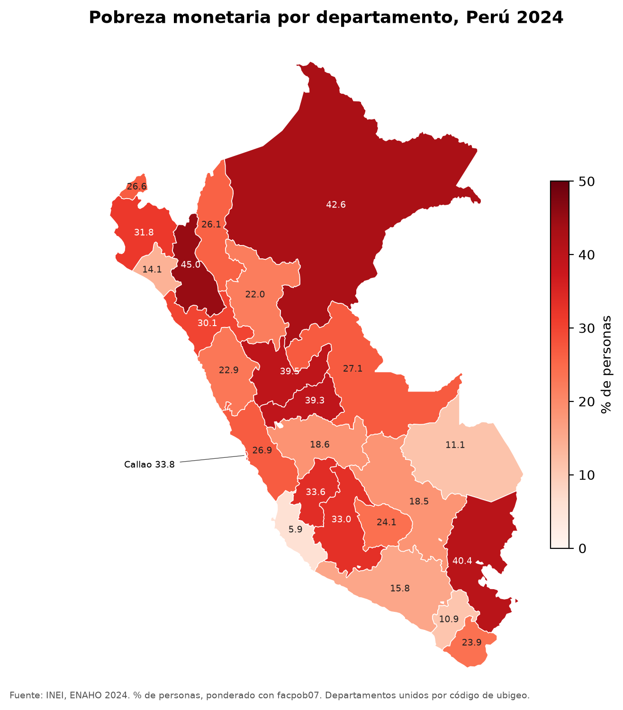

# enaho-skills

Tres skills de Claude Code que convierten los módulos de la ENAHO 2024 del INEI en una base de personas, la validan contra la pobreza oficial y producen gráficos y un mapa por departamento. Cualquiera que clone el repo obtiene la misma base, las mismas cifras y las mismas figuras.

| Skill | Entra | Sale |
|---|---|---|
| [`limpiando-enaho`](.claude/skills/limpiando-enaho/SKILL.md) | `datos/966-Modulo34.zip` y `datos/966-Modulo02.zip` | `salidas/personas_2024.parquet` y `salidas/validacion.txt` |
| [`graficando-enaho`](.claude/skills/graficando-enaho/SKILL.md) | La base limpia y un corte: área, sexo, edad, dominio o departamento | `figuras/*.png` |
| [`mapeando-enaho`](.claude/skills/mapeando-enaho/SKILL.md) | La base limpia y los límites de los 25 departamentos (incluidos en la skill) | `mapas/pobreza_departamento.png` |

Las skills de gráficos y mapas encadenan la de limpieza: si la base no existe, usan primero `limpiando-enaho`. Así, un solo pedido como «haz un mapa de la pobreza por departamento» activa dos skills seguidas.

## Requisitos

- [uv](https://docs.astral.sh/uv/) (instala Python 3.12 y las dependencias exactas de `uv.lock`)
- [Claude Code](https://code.claude.com/docs) para usar las skills y correr la evaluación

## 1. Clonar e instalar

```bash
git clone <url-de-este-repo> enaho-skills
cd enaho-skills
uv sync
mkdir -p datos
```

## 2. Bajar los datos

Los microdatos no se suben al repo. Bájenlos desde el navegador (código 966 = ENAHO 2024) y guarden los zip, sin descomprimir, en `datos/`. Sirve la versión STATA o la CSV del portal; si usan el [portal de microdatos](https://proyectos.inei.gob.pe/microdatos/), es *ENAHO Metodología actualizada → Condiciones de vida y pobreza → 2024 → Anual*, módulos 02 y 34.

| Módulo | Archivo | Una fila por | Factor |
|---|---|---|---|
| 34 · Sumaria | [966-Modulo34.zip](https://proyectos.inei.gob.pe/iinei/srienaho/descarga/STATA/966-Modulo34.zip) (16 MB) | hogar | `factor07` |
| 02 · Miembros del hogar | [966-Modulo02.zip](https://proyectos.inei.gob.pe/iinei/srienaho/descarga/STATA/966-Modulo02.zip) (6 MB) | persona | `facpob07` |

```text
datos/
├── 966-Modulo34.zip
└── 966-Modulo02.zip
```

El GeoJSON de los departamentos ya viene en `.claude/skills/mapeando-enaho/recursos/`.

## 3. Usarlo con Claude Code

Abran Claude Code en la raíz del repo (`claude`) y pidan en lenguaje natural:

```text
¿Cuál fue la pobreza en Cusco en 2024?
Grafica la pobreza urbana y rural
Haz un mapa de la pobreza por departamento
```

O llamen cada skill a mano: `/limpiando-enaho 2024`, `/graficando-enaho sexo`, `/mapeando-enaho`. Con `/skills` ven las que están disponibles.

## 4. O correr todo sin Claude

Los scripts son los mismos que usan las skills:

```bash
uv run .claude/skills/limpiando-enaho/scripts/limpiar.py --anio 2024
uv run .claude/skills/limpiando-enaho/scripts/consultar.py --por departamento
uv run .claude/skills/graficando-enaho/scripts/graficar.py --por area
uv run .claude/skills/mapeando-enaho/scripts/mapear.py
```

## Cómo se limpia

`limpiar.py` sigue siempre los mismos siete pasos:

1. **Leer** los `.dta` con `convert_categoricals=False`, para quedarse con los códigos.
2. **Normalizar** nombres de columna a minúscula (`aÑo` pasa a `anio`) y las llaves a texto con ceros: `conglome` 6, `vivienda` 3, `hogar` 2, `codperso` 2 y `ubigeo` 6 dígitos.
3. **Filtrar** residentes habituales: `(p204 == 1 & p205 == 2) | (p204 == 2 & p206 == 1)`.
4. **Unir** personas con su hogar con `validate="m:1"`: si un hogar está repetido, falla en vez de duplicar personas.
5. **Construir** `departamento = ubigeo[:2]`, `urbano = estrato <= 5`, `pobre = pobreza <= 2`, `pobre_extremo = pobreza == 1`, sexo y grupos de edad.
6. **Validar** llaves únicas, que la unión no pierda ni duplique filas, 25 departamentos y las cifras oficiales.
7. **Guardar** la base y `salidas/validacion.txt`. Si algo falla, la base **no** se guarda.

Las cifras de personas se ponderan con `facpob07`. El detalle de variables y trampas está en [`reference.md`](.claude/skills/limpiando-enaho/reference.md).

## Validación

`salidas/validacion.txt` debe decir `RESULTADO: OK`. Lo que se comprueba para 2024:

| Cifra | Esperado |
|---|---|
| Pobreza monetaria | 27.6 % (INEI); 27.58 % con la sumaria y `factor07 × mieperho`, 27.53 % con personas y `facpob07` |
| Pobreza extrema | 5.5 % |
| Hogares en la sumaria | 33,691 |
| Residentes habituales | 108,664 de 117,721 filas del módulo 02 |
| Pobreza por departamento | Los 25 valores de `recursos/pobreza_departamento_2024.csv`, en `mapear.py` |

## Resultados

`salidas/validacion.txt` con los archivos 2024: **RESULTADO: OK**. Pobreza 27.58 % con la sumaria y 27.53 % con personas, pobreza extrema 5.50 %, 33,691 hogares y 108,664 residentes. Los 25 departamentos replican la cifra oficial con una diferencia máxima de 0.05 puntos.



Gráficos en [`figuras/`](figuras/): por área, sexo, grupo de edad, dominio y departamento.

## Reglas de las figuras

| Gráficos (`graficando-enaho`) | Mapa (`mapeando-enaho`) |
|---|---|
| Ponderados con `facpob07` | Unión por código: `ubigeo[:2]` con `FIRST_IDDP`, nunca por nombre |
| Barras desde cero, ordenadas | 25 departamentos con dato; Lima (15) y Callao (07) separados |
| Un solo color, valor escrito en cada barra | Un solo tono, de claro a oscuro, desde 0 |
| Título con qué y cuándo; fuente al pie | Leyenda con la unidad: % de personas |
| PNG a 200 dpi en `figuras/` | PNG a 200 dpi en `mapas/` |

## Evaluación con y sin skills

```bash
bash evaluacion/evaluar.sh
```

Corre los tres pedidos con `claude -p`, con skills y sin ellas (`--disallowedTools Skill`), cada uno en una carpeta temporal limpia. Anota qué skills se activaron y en qué orden en [`evaluacion/automatico.md`](evaluacion/automatico.md); las conclusiones están en [`evaluacion.md`](evaluacion.md).

## Estructura

```text
.claude/skills/
├── limpiando-enaho/   SKILL.md · reference.md · scripts/limpiar.py · scripts/consultar.py
├── graficando-enaho/  SKILL.md · scripts/graficar.py
└── mapeando-enaho/    SKILL.md · scripts/mapear.py · recursos/ (GeoJSON y pobreza oficial)
salidas/validacion.txt
figuras/  mapas/
evaluacion/  evaluacion.md
pyproject.toml  uv.lock
```

## Si algo falla

| Síntoma | Qué hacer |
|---|---|
| `FALTAN DATOS` | Bajen los dos zip a `datos/` con los nombres de arriba |
| `RESULTADO: FALLA` | Revisen los chequeos marcados con `X` en `salidas/validacion.txt` |
| `MAPA NO GENERADO` | La unión por código falló o un departamento no replica la cifra oficial; el mensaje dice cuál |
| La skill no se activa sola | Llámenla con `/nombre` o revisen su `description` |
| La skill no aparece | Si crearon `.claude/skills` con Claude Code abierto, reinícienlo |

Fuentes: INEI, ENAHO 2024. Límites departamentales del [repositorio del curso](https://github.com/d2cml-ai/Data-Science-Python).
